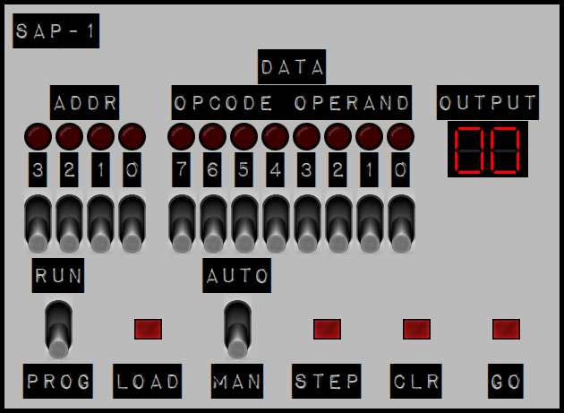

# SAP-1-CPU

[](https://github.com/ellisgl/SAP-1-CPU/actions/workflows/deploy.yml)
[](LICENSE.BSD)

SAP-1 like CPU / Computer Simulator in HTML and JavaScript.



**[Play with it here!](https://ellisgl.github.io/SAP-1-CPU/)**

The FPGA version is available (Mojo FPGA V3) [here](https://github.com/ellisgl/sap-1-v2-mojo).

## What is the SAP-1?

The SAP-1 ("Simple As Possible") is the teaching computer from Albert Malvino and Jerald Brown's *Digital Computer
Electronics*. It is about the smallest design that still works like a real stored-program computer:

- 8-bit data bus (the W bus), accumulator (register A) and register B
- 16 bytes of RAM, addressed by a 4-bit program counter and memory address register
- An adder/subtractor ALU
- An output register driving a two-digit display
- 5 instructions, each running in a fixed 6-step (T1-T6) fetch/execute cycle

This simulator models each of those parts and the control signals between them, so you can watch a program execute one
clock pulse at a time.

## Using the front panel

| Control      | What it does                                                                                    |
|--------------|-------------------------------------------------------------------------------------------------|
| ADDR 3-0     | Address switches - which RAM location LOAD writes to.                                           |
| DATA 7-0     | Data switches - the byte LOAD writes.                                                           |
| RUN / PROG   | PROG lets you enter a program; RUN executes it.                                                 |
| LOAD         | Writes the data switches into RAM at the address switches.                                      |
| AUTO / MAN   | AUTO runs from a 1 Hz clock; MAN lets you single-step.                                          |
| STEP         | Sends one clock pulse, advancing one T-state (RUN + MAN only).                                  |
| CLR          | Resets the CPU **and clears RAM**.                                                              |
| GO           | Starts or stops the automatic clock (RUN + AUTO only). The clock also stops when HLT runs.      |

The LEDs above the switches show the current RAM address and the contents of the W bus, and OUTPUT shows the output
register in hex.

To enter and run a program:

1. Set **RUN / PROG** to **PROG** and press **CLR**. Clear wipes RAM, so do this *before* loading.
2. For each byte: set the **ADDR** and **DATA** switches, then press **LOAD**.
3. Set **RUN / PROG** to **RUN**.
4. Either set **MAN** and press **STEP** repeatedly (6 presses per instruction), or set **AUTO** and press **GO**.

The **DEBUG** line under the panel shows the current T-state, program counter, decoded opcode, registers A and B, and the
full RAM contents.

## Instruction set

Each instruction is one byte: the upper 4 bits are the opcode and the lower 4 bits are a RAM address.

| Opcode | Mnemonic | Description                                       |
|--------|----------|---------------------------------------------------|
| `0000` | LDA      | Load the byte at the address into the accumulator |
| `0001` | ADD      | Add the byte at the address to the accumulator    |
| `0010` | SUB      | Subtract the byte at the address from it          |
| `1110` | OUT      | Copy the accumulator to the output display        |
| `1111` | HLT      | Halt (and stop the clock)                         |

Results are 8-bit and wrap around: `200 + 100` shows `2C` (44), and `1 - 2` shows `FF` (255). Like the original SAP-1,
there are no jumps, conditionals or flags.

### Example: 1 + 2

| ADDR   | DATA        | Meaning  |
|--------|-------------|----------|
| `0000` | `0000 1010` | LDA 1010 |
| `0001` | `0001 1011` | ADD 1011 |
| `0010` | `1110 0000` | OUT      |
| `0011` | `1111 0000` | HLT      |
| `1010` | `0000 0001` | Data: 1  |
| `1011` | `0000 0010` | Data: 2  |

The display shows `03`.

### Example: 5 + 4 - 2

| ADDR   | DATA        | Meaning  |
|--------|-------------|----------|
| `0000` | `0000 1101` | LDA 1101 |
| `0001` | `0001 1110` | ADD 1110 |
| `0010` | `0010 1111` | SUB 1111 |
| `0011` | `1110 0000` | OUT      |
| `0100` | `1111 0000` | HLT      |
| `1101` | `0000 0101` | Data: 5  |
| `1110` | `0000 0100` | Data: 4  |
| `1111` | `0000 0010` | Data: 2  |

The display shows `07`.

## Development

There is no build step - open `index.html` in a browser to run the simulator locally.

```
js/
  cpu.js       CPU components (control unit, PC, MAR, RAM, IR, registers, ALU, output) and their control signals
  main.js      Front panel wiring and display updates
  helpers.js   Binary/decimal/hex conversion helpers
tests/
  harness.js   Loads the browser scripts into Node with a stub DOM and a fake clock
  *.test.js    Tests for helpers.js and the CPU
```

The components talk to each other through events on a shared `EventTarget` (`ee`), e.g. every clock edge dispatches a
`CLK` event that each clocked component listens for.

### Tests

Requires Node.js 22 or later; there are no dependencies to install.

```
npm test
```

The CPU tests drive the real front panel wiring - setting switches, pressing LOAD/STEP/GO - and run programs to
completion using a simulated clock, so the whole suite finishes in well under a second.

### Deployment

Every push to `release` runs the tests and, if they pass, publishes the site to the `gh-pages` branch via
[GitHub Actions](.github/workflows/deploy.yml), which updates the [live page](https://ellisgl.github.io/SAP-1-CPU/).

## Contributing

Contributions are welcome! Please run `npm test` before opening a pull request, and see
[CONTRIBUTING.md](CONTRIBUTING.md) and the [Code of Conduct](CODE_OF_CONDUCT.md).

## Credits

- SAP-1 architecture from *Digital Computer Electronics* by Albert Paul Malvino and Jerald A. Brown.
- [DSEG7 Classic](https://www.keshikan.net/fonts-e.html) seven-segment font by Keshikan.
- Impact Label font, copyright (c) 2008 Michael Tension.

## License

[BSD 3-Clause](LICENSE.BSD)
